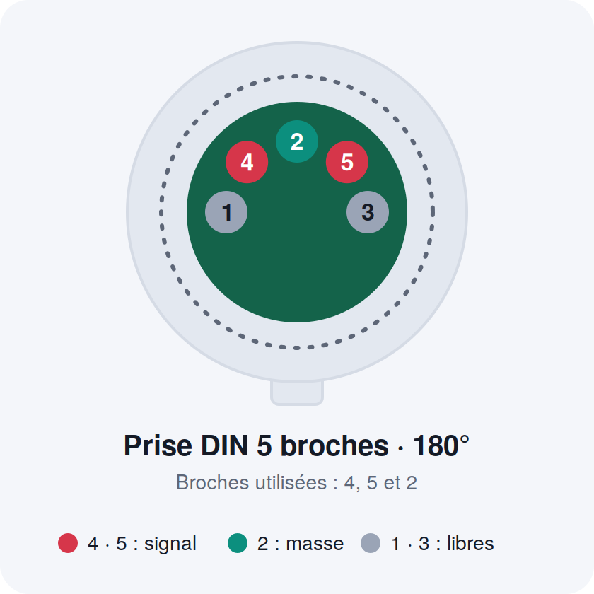
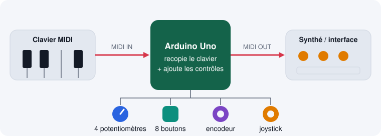
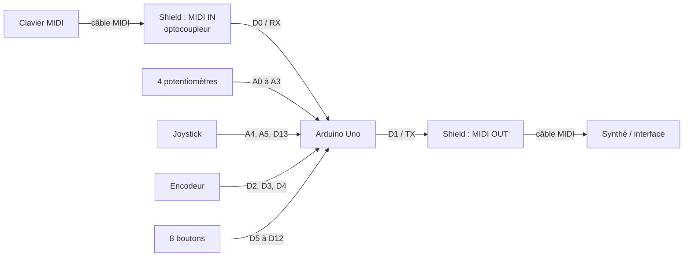
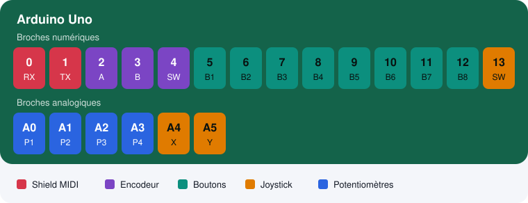
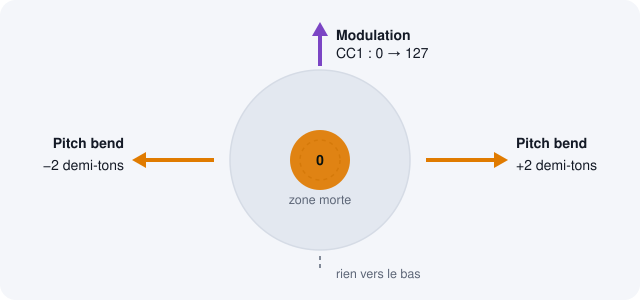
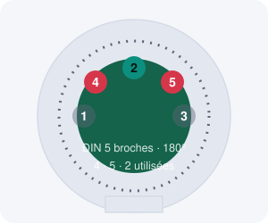

# Contrôleur MIDI « merge » sur Arduino Uno

<p align="center"></p>

Documentation complète du projet (version logicielle **v3**).

> **Avertissement** : le code n'a pas été testé sur le matériel au moment de la rédaction. Les sections *Tests* et *Dépannage* servent à le valider pas à pas.

---

## Contenu du dépôt

```

├── README.md                    ← ce document
├── docs/
│   ├── guide.html               ← version illustrée (à ouvrir dans un navigateur)
│   └── images/                  ← schémas SVG (principe, brochage, joystick, prise DIN)
└── midi_merge.ino               ← sketch Arduino (v3)
```

La version illustrée `docs/guide.html` est un fichier unique, sans dépendance : elle peut aussi être publiée avec GitHub Pages.

---

## Sommaire

1. [Objectif du projet](#1-objectif-du-projet)
2. [Matériel](#2-matériel)
3. [Schéma matériel](#3-schéma-matériel)
4. [Messages MIDI générés](#4-messages-midi-générés)
5. [Fonctionnement du logiciel](#5-fonctionnement-du-logiciel)
6. [Installation et mise en route](#6-installation-et-mise-en-route)
7. [Réglages modifiables](#7-réglages-modifiables)
8. [Tests et validation](#8-tests-et-validation)
9. [Dépannage](#9-dépannage)
10. [Boîtier et prises MIDI déportées](#10-boîtier-et-prises-midi-déportées)
11. [Limites connues et évolutions possibles](#11-limites-connues-et-évolutions-possibles)
12. [Annexe : code source complet (v3)](#12-annexe--code-source-complet-v3)

---

## 1. Objectif du projet

Construire un boîtier MIDI qui se place **entre un clavier MIDI et un synthétiseur** (ou une interface son) :

- le boîtier reçoit sur **MIDI IN** tout ce que joue le clavier (notes, vélocité, pédales, molettes…) ;
- il **recopie intégralement** ces messages vers **MIDI OUT** ;
- il y **ajoute**, sur le **même canal MIDI**, les contrôles de ses propres composants (potentiomètres, boutons, encodeur, joystick) ;
- le tout sort **mélangé sur une seule sortie MIDI**.

Le boîtier peut aussi fonctionner **en contrôleur autonome**, sans rien sur MIDI IN : seuls les messages des composants sortent, sur le canal 1.



---

## 2. Matériel

| Élément | Quantité | Rôle |
|---|---|---|
| Arduino Uno | 1 | Cerveau du montage |
| Shield MIDI (IN / OUT / THRU) | 1 | Interface MIDI (optocoupleur en entrée, sortie, switch RUN/PROG) |
| Potentiomètres | 4 | Contrôle continu (CC) |
| Boutons on/off | 8 | Contrôles tout ou rien (CC) |
| Encodeur numérique avec clic | 1 | Valeur relative + remise à zéro |
| Mini joystick 2 axes avec clic | 1 | Pitch bend, modulation, bouton |
| Prises DIN 5 broches femelles pour panneau | 2 | IN et OUT déportés sur le boîtier (voir §10) |
| Fils, boîtier, alimentation | — | USB ou 7-12 V sur la prise jack |

> **Prise THRU du shield** : c'est une copie matérielle de l'entrée, elle ne contient **pas** les contrôles ajoutés. Elle n'est pas utilisée dans ce projet. Le synthé se branche sur **OUT**.

---

## 3. Schéma matériel

### 3.1 Architecture



### 3.2 Tableau des broches

Les 20 broches de l'Uno sont toutes utilisées.



| Broche | Composant | Fonction |
|---|---|---|
| **D0** | Shield MIDI | RX : réception MIDI IN (port série matériel) |
| **D1** | Shield MIDI | TX : émission vers MIDI OUT |
| **D2** | Encodeur | Voie A (CLK) |
| **D3** | Encodeur | Voie B (DT) |
| **D4** | Encodeur | Clic (SW) |
| **D5 à D12** | Boutons 1 à 8 | Un côté sur la broche, l'autre sur GND |
| **D13** | Joystick | Clic (SW) |
| **A0 à A3** | Potentiomètres 1 à 4 | Curseur (broche centrale) |
| **A4** | Joystick | Axe X (VRx) |
| **A5** | Joystick | Axe Y (VRy) |

### 3.3 Câblage composant par composant

**Potentiomètres (×4)**
```
 5V ──┐
      ├── patte 1
 A0 ──── patte centrale (curseur)     (A1, A2, A3 pour les suivants)
      ├── patte 3
 GND ─┘
```
Inverser les pattes 1 et 3 inverse le sens de rotation.

**Joystick**
| Joystick | Arduino |
|---|---|
| +5V | 5V |
| GND | GND |
| VRx | A4 |
| VRy | A5 |
| SW | D13 |

**Encodeur**
| Encodeur | Arduino |
|---|---|
| CLK (A) | D2 |
| DT (B) | D3 |
| SW | D4 |
| GND (ou « - ») | GND |
| + | non utilisé (ou 5V si le module en a besoin) |

Si le sens de rotation est inversé, échangez les fils CLK et DT.

**Boutons (×8)**
```
 D5..D12 ──── bouton ──── GND
```
Aucune résistance externe : les broches utilisent le pull-up interne (`INPUT_PULLUP`). Un bouton appuyé lit donc `LOW`.

**Alimentation commune** : tous les GND (potentiomètres, joystick, encodeur, boutons) doivent être reliés au GND de l'Arduino.

### 3.4 Shield MIDI

- Le shield s'empile sur l'Uno ; ses connecteurs repassent les broches vers le haut pour câbler les composants.
- Il utilise le **port série matériel D0/D1**. Ces broches ne doivent donc rien porter d'autre.
- **Switch du shield** :
  - position *PROG* : l'entrée MIDI est déconnectée de RX, nécessaire pour **téléverser** ;
  - position *RUN* : fonctionnement normal.
  Le libellé exact dépend de votre modèle.
- **Conflits possibles** : certains shields MIDI (modèle SparkFun, par exemple) ont des boutons ou LED sur D2, D3, D6, D7 ou sur A0 à A2. Ce n'est pas le cas visible sur la photo de votre shield, mais à vérifier au multimètre si un composant se comporte mal.

---

## 4. Messages MIDI générés

Tous les messages ajoutés sortent sur le **canal du clavier** : le code mémorise le canal de la dernière note reçue. Tant qu'aucune note n'est arrivée (ou en mode autonome), le **canal 1** est utilisé.

| Composant | Broche | Message | Valeurs |
|---|---|---|---|
| Potentiomètre 1 | A0 | CC 20 | 0 à 127 |
| Potentiomètre 2 | A1 | CC 21 | 0 à 127 |
| Potentiomètre 3 | A2 | CC 22 | 0 à 127 |
| Potentiomètre 4 | A3 | CC 23 | 0 à 127 |
| Joystick, axe X | A4 | **Pitch bend** | -8192 (gauche) à +8191 (droite), 0 au centre |
| Joystick, axe Y | A5 | **CC 1** (modulation) | 0 au centre à 127 vers le haut ; rien vers le bas |
| Joystick, clic | D13 | CC 110 | 127 à l'appui, 0 au relâchement |
| Encodeur, rotation | D2/D3 | CC 30 | 0 à 127, pas de 2 par cran |
| Encodeur, clic | D4 | CC 30 | remet la valeur à 64 |
| Bouton 1 à 8 | D5 à D12 | CC 102 à 109 | 127 à l'appui, 0 au relâchement |



**Pitch bend et demi-tons** : la pleine course du joystick envoie ±8192, soit **±2 demi-tons** si le synthé est réglé sur la plage standard de ±2 (c'est le réglage par défaut de la plupart). Si votre synthé a une autre plage de bend, réglez-la dans le synthé.

---

## 5. Fonctionnement du logiciel

### 5.1 Recopie du clavier (Thru)

La bibliothèque MIDI est configurée en recopie complète :

```cpp
MIDI.begin(MIDI_CHANNEL_OMNI);      // écoute tous les canaux
MIDI.turnThruOn(midi::Thru::Full);  // recopie tout vers la sortie
```

À chaque appel de `MIDI.read()`, les messages complets reçus sont renvoyés sur la sortie. Les messages des composants sont envoyés avec `MIDI.sendControlChange()` et `MIDI.sendPitchBend()` dans la même boucle, donc **mélangés** à ce flux.

### 5.2 Réglages anti-perte de l'instance MIDI

```cpp
struct MySettings : public midi::DefaultSettings {
  static const bool Use1ByteParsing = false;                  // lit tout le tampon à chaque read()
  static const bool HandleNullVelocityNoteOnAsNoteOff = false; // ne modifie pas les Note On vélocité 0
  static const bool UseRunningStatus = true;                  // moins d'octets envoyés
  static const unsigned SysExMaxSize = 256;                   // sysex plus longs = tronqués
};
```

La bibliothèque n'offre pas de réglage qui désactive purement la vérification des données ; ce sont les options les plus proches.

### 5.3 Boucle principale

```
loop():
    MIDI.read()                          ← clavier → sortie
    1 lecture analogique (tournante) :   ← A0, A1, A2, A3, A4, A5, puis recommence
    MIDI.read()
    encodeur, clic joystick, 8 boutons
```

Une seule lecture analogique (~0,1 ms) est faite par tour, pour ne jamais retarder la lecture du MIDI entrant (tampon de réception de l'Uno : 64 octets, environ 20 ms de MIDI). La variable `step` (0 à 5) est remise à zéro par un modulo : aucun risque de dépassement.

### 5.4 Détails par composant

- **Potentiomètres** : lecture 10 bits, filtre de bruit (variation d'au moins 4 sur 1023), conversion en 7 bits, envoi seulement si la valeur change.
- **Joystick** : le centre est **calibré au démarrage** (ne pas toucher au joystick à l'allumage). Zone morte de 25 et butée atteinte 40 avant la fin de course. La réponse est progressive entre ces deux bornes. Le bend n'est envoyé que si la variation dépasse 48, ou lors d'un retour exact au centre ou aux butées.
- **Encodeur** : décodage par table d'états (4 transitions = 1 cran), pas de 2 par cran, valeur bornée à 0-127, clic = retour à 64.
- **Boutons** : anti-rebond de 20 ms, mode momentané par défaut (127 à l'appui, 0 au relâchement), ou basculement si `BUTTONS_TOGGLE = true`.
- **Canal** : mis à jour à chaque Note On / Note Off reçu.

---

## 6. Installation et mise en route

1. **Bibliothèque** : dans l'IDE Arduino, gestionnaire de bibliothèques, installer **« MIDI Library »** de Francois Best (FortySevenEffects).
2. **Carte** : Arduino Uno.
3. **Switch du shield** : position *PROG*.
4. Ouvrir `firmware/midi_merge_v3/midi_merge_v3.ino`, puis **téléverser**.
5. Remettre le switch en position *RUN*.
6. Brancher le clavier sur **MIDI IN** et le synthé sur **MIDI OUT**.
7. Alimenter par l'USB, ou par une alimentation 7-12 V sur la prise jack.
8. Ne pas toucher au joystick pendant la mise sous tension (calibrage).

> Le moniteur série de l'IDE ne sert à rien ici : le port série est utilisé par le MIDI.

---

## 7. Réglages modifiables

Tous en haut du fichier :

| Constante | Défaut | Effet |
|---|---|---|
| `POT_CC[4]` | 20 à 23 | Numéros de CC des potentiomètres |
| `BTN_CC[8]` | 102 à 109 | Numéros de CC des boutons |
| `JOY_Y_CC` | 1 | CC de l'axe Y (1 = modulation) |
| `JOY_SW_CC` | 110 | CC du clic du joystick |
| `ENC_CC` | 30 | CC de l'encodeur |
| `ENC_STEP` | 2 | Incrément par cran |
| `BUTTONS_TOGGLE` | `false` | `true` = chaque appui bascule 0/127 |
| `JOY_DEADZONE` | 25 | Zone morte du joystick (sur 1023) |
| `JOY_MARGIN` | 40 | Marge avant la butée |
| `INVERT_Y` | `false` | `true` si « haut » ne donne pas de modulation |
| `SysExMaxSize` | 256 | Taille max d'un sysex recopié |

---

## 8. Tests et validation

Procéder dans cet ordre, pour isoler les problèmes.

### 8.1 Test de la recopie seule (matériel)

Téléverser ce mini-sketch (switch en *PROG*, puis *RUN*) :

```cpp
void setup() { Serial.begin(31250); }
void loop()  { if (Serial.available()) Serial.write(Serial.read()); }
```

Jouer sur le clavier : si les notes ressortent sur OUT, le matériel (câblage, switch, optocoupleur) est bon.

### 8.2 Test du contrôleur autonome

Sans rien sur MIDI IN, téléverser la v3 et brancher OUT sur un synthé ou une interface. Bouger les composants : les messages sortent sur le canal 1.

### 8.3 Voir les messages en clair, sans le shield

Avec l'Uno en USB, les mêmes octets sortent sur le port USB :

1. Installer **Hairless MIDI↔Serial Bridge** et un port MIDI virtuel (**loopMIDI** sous Windows).
2. Dans Hairless : choisir le port de l'Uno, vitesse **31250**.
3. Ouvrir un moniteur MIDI (**MIDI-OX**, **MIDIberry**…) sur le port virtuel : chaque CC et chaque bend s'affiche avec ses valeurs.

### 8.4 Simulation (optionnelle)

**Wokwi** (wokwi.com) simule un Uno avec potentiomètres, boutons, encodeur et joystick. Il permet de vérifier que les composants réagissent, mais il n'affiche pas le MIDI en clair et ne simule pas de clavier MIDI en entrée, donc il ne remplace pas §8.3.

### 8.5 Test complet

Clavier sur IN, synthé sur OUT : jouer des notes en tournant un potentiomètre ou en bougeant le joystick. Les notes doivent sonner sans trou, et les contrôles agir sur le même canal.

---

## 9. Dépannage

| Symptôme | Cause probable | Action |
|---|---|---|
| Aucun message ne sort | Switch du shield mal positionné | Mettre sur *RUN* (et sur *PROG* pour téléverser) |
| Téléversement impossible | Switch en *RUN* ou clavier branché | Passer en *PROG*, débrancher le MIDI IN |
| Les notes du clavier ne ressortent pas | Câblage IN / OUT inversé, ou optocoupleur non alimenté | Test §8.1, vérifier les branchements |
| Rien en entrée mais les contrôles sortent | Problème limité à l'entrée (broches 4/5 du DIN IN inversées, câble) | Inverser les broches 4 et 5 de l'entrée |
| Le synthé reçoit des notes mais pas les CC | CC non assignés dans le synthé | Utiliser « MIDI learn » ou un moniteur MIDI |
| CC aléatoires sur une entrée | Entrée analogique non câblée (flottante) | Câbler le potentiomètre ou la brancher à GND |
| Pitch bend décalé au repos | Joystick touché au démarrage | Redémarrer sans toucher au joystick |
| Sens du joystick Y inversé | Montage mécanique | `INVERT_Y = true` |
| Sens de l'encodeur inversé | CLK / DT inversés | Échanger les deux fils |
| Bend sans effet audible | Plage de bend du synthé à 0 | Régler la plage à ±2 dans le synthé |
| Un bouton envoie plusieurs messages | Rebonds mécaniques importants | Augmenter l'anti-rebond (20 ms) |
| Sysex tronqué ou perdu | Message plus long que `SysExMaxSize` | Augmenter la valeur (consomme de la RAM) |
| Notes perdues pendant des gestes rapides | Charge trop forte sur la boucle | Retirer des composants non utilisés, ou me demander une version à recopie par octets |

---

## 10. Boîtier et prises MIDI déportées

### 10.1 Deux méthodes

**A. Dessouder les prises DIN du shield** et câbler des prises panneau par des fils courts (10 à 30 cm, de préférence torsadés).
**B. Sans soudure** : brancher sur les prises du shield des rallonges DIN 5 broches avec prise femelle à fixer sur panneau (« MIDI panel mount extension cable »).

### 10.2 Broches utiles (DIN 5 broches, 180°)



| Prise | Broches à câbler | Rôle |
|---|---|---|
| **OUT** | 5, 4, 2 | 5 = signal, 4 = +5 V (via 220 Ω), 2 = masse |
| **IN** | 4 et 5 | Boucle de courant vers l'optocoupleur |

- Les broches 1 et 3 ne servent pas.
- Ne **pas** relier la broche 2 de l'entrée IN (la norme demande de la laisser libre).
- Si rien n'arrive à l'Arduino, inverser les broches 4 et 5 de l'entrée.

### 10.3 Précautions

- Fils courts, éloignés des potentiomètres et du joystick.
- Boîtier métallique : isoler les prises (collerette plastique ou rondelle isolante) pour éviter une boucle de masse.
- Rallonges du commerce : vérifier **5 conducteurs**, câblage **1:1**, **180°** (pas 240° ni 3 broches).
- Il faut 2 prises (IN et OUT) ; le THRU n'est pas utilisé.

---

## 11. Limites connues et évolutions possibles

**Limites**
- Code **non testé sur matériel** à la date de rédaction.
- Toutes les broches de l'Uno sont utilisées : pas de place pour des LED ou un afficheur sans changer de carte.
- Pas de logs possibles sans sacrifier une broche (une version de test avec logs sur D4 avait été étudiée puis abandonnée comme trop complexe).
- Les messages temps réel (horloge, etc.) sont recopiés, mais le temps de traitement des composants s'ajoute au trajet du MIDI (latence faible).
- Un sysex plus long que `SysExMaxSize` peut être tronqué.

**Évolutions possibles**
- Version à recopie **octet par octet** avec tampon (aucune interprétation, insertion des CC entre deux messages) si la bibliothèque pose problème.
- Envoi d'un **RPN** au démarrage pour forcer la plage de pitch bend à ±2 demi-tons.
- Canal MIDI fixe réglable, ou sélectionnable avec l'encodeur.
- Passage à une carte avec plus d'entrées (Mega) pour ajouter des contrôles ou des LED.

---

